# SignVoice

**Continuous Indian Sign Language Recognition and Translation into English Text and Speech Using Deep Learning**

An MCA research project with an executable PyTorch training pipeline and Gradio upload/webcam-recording application.

**Current status:** Implementation and engineering checks work. Real-data training is **blocked by dataset network access** in the development environment. No real translation checkpoint or research metrics are included. `models/smoke.pt` is a synthetic engineering artifact and the app explicitly refuses it. This is not yet a completed, evaluated ISL translator.

## Quick start

Use Python **3.11** (tested: 3.11.17) and Git. From this directory:

```bash
python3.11 -m venv .venv
source .venv/bin/activate
python -m pip install --upgrade pip
# CPU development, preserving TLS verification:
pip install -r requirements.txt --extra-index-url https://download.pytorch.org/whl/cpu
python -m pytest -q
python -m scripts.smoke
python app.py
```

For an exact repeat of the tested Linux CPU environment, use `requirements-lock-cpu.txt` with the same PyTorch CPU index. For Colab GPU training use `requirements.txt` from PyPI as the notebook does; the CPU lock is not a GPU environment. `requirements-dev.txt` additionally installs the screenshot driver; it expects system Chromium for `scripts/browser_check.py`.

Open the local Gradio URL printed by the server in your browser. Camera use requires browser permission and a secure context (local browser or HTTPS). No public deployment is started automatically. The app starts without a checkpoint and explains why translation is unavailable.

## Exact Google Colab workflow

1. Open `notebooks/SignVoice_Training.ipynb` in Google Colab. Select **Runtime → Change runtime type → T4 GPU**.
2. Run the first cell; mount Drive and upload **SignVoice-project.zip** when prompted. It creates a Python 3.11 environment and verifies CUDA.
3. Run the dataset inventory cell. Inspect actual licenses, gating, file sizes and README. If access is gated, accept the terms and authenticate through a secure HF prompt; never paste tokens into source code.
4. Set `HF_FILES` to **actual raw-video and English annotation filenames** from that inventory. Download/extract. Set `CSV_PATH` and `VIDEO_DIR` to the printed real paths. File names cannot be supplied honestly before access is available.
5. Run preparation with `LIMIT = 100`. It must report at least 100 decodable, matched video/text examples. Inspect the audit; there must be three nonempty disjoint splits.
6. Run engineering tests, baseline, and the two-epoch initial sequence-to-text training. Check autoregressive evaluation and a real held-out video.
7. Increase `LIMIT` to 1000 (then 3000 if feasible), rerun preparation, set a **new** `MODEL_DIR`, and train 20–40 epochs. Inspect validation curves; use early stopping, not the test set, to choose the model.
8. Evaluate, save real prediction tables and curves, and download `best.pt` plus `evaluation.json`. Place them in `models/best.pt` and `reports/evaluation.json` locally.
9. Run `python app.py`. Test upload and webcam recording, play/download the audio, and capture the actual successful outputs for your report.

The notebook has no saved outputs claiming experiments were run. It cannot be run unattended until exact available dataset assets are selected. Source files are created locally in this workspace; they have not been pushed to GitHub.

## Dataset decision and compatibility

The provisional target is **ISLTranslate raw videos distributed through iSign**, because its official repository verifies continuous English-aligned annotations and describes raw-video assets. The checked official CSV contains **31,222 nonempty uid/text annotation rows**. Those are annotations, not 31,222 verified video samples. Dataset access, full asset inventory, and current license acceptance remain prerequisites. See [dataset investigation](reports/dataset-investigation.md).

We do **not** load unverified precomputed poses. Raw videos are re-extracted by the same MediaPipe code used in the app. Every manifest row and checkpoint contains its preprocessing configuration. Imported poses require a separately verified converter with landmark order, units, sampling, missing-value and normalization equivalence; matching a feature dimension is insufficient.

## Reproducible commands after raw data is available

```bash
python scripts/inspect_datasets.py
# Select exact asset names printed by that script:
python scripts/download_data.py --repo Exploration-Lab/iSign --files ACTUAL_FILE_NAMES
python scripts/extract_archive.py ACTUAL_ARCHIVE data/raw/unique_destination
python -m src.prepare --csv ACTUAL_CSV --videos ACTUAL_VIDEO_DIRECTORY --limit 1000
python -m src.baseline --data data/prepared --output reports/baseline --epochs 10
python -m src.train --data data/prepared --output models --epochs 30 --batch-size 16
python -m src.evaluate --data data/prepared --checkpoint models/best.pt --output reports/evaluation.json
# Resume SAME data/model/output; --epochs is total desired epochs:
python -m src.train --data data/prepared --output models --epochs 40 --resume models/last.pt
```

`ACTUAL_*` items are explicit placeholders requiring inventory inspection, not claimed existing folders. Preparation only supports verified `uid,text` annotations and exact video-stem matching; it stops on incompatible schemas. Copy data and reports to Drive to survive Colab runtime deletion. Keep `best.pt` and `last.pt` together for resume. Never run downloaded dataset code.

## Architecture

```mermaid
flowchart LR
  A[Upload or webcam recording] --> B[OpenCV sampling at 12 fps]
  B --> C[MediaPipe body + both hands + face]
  C --> D[94 landmarks x 4 channels]
  D --> E[Missing-keypoint handling and shoulder normalization]
  E --> F[Projection and packed BiLSTM]
  F --> G[Masked attention GRU decoder]
  G --> H[Autoregressive English tokens]
  H --> I[gTTS audio]
```



The model processes connected temporal sequences, not isolated alphabet labels. A word-level vocabulary fitted on training data limits output vocabulary; unseen English words become `<unk>`. Maximum sequence length is 192 sampled frames; longer sequences up to 60 seconds are uniformly reduced. Targets are limited to 64 tokens including BOS/EOS. The lightweight model is a research baseline, not a promise of accurate general-purpose translation.

Training uses AdamW, token cross-entropy ignoring padding, packed lengths, attention masks, gradient clipping, ReduceLROnPlateau, validation-based early stopping, reproducible seeds, and atomic best/last checkpoints with optimizer/RNG state. Test predictions use autoregressive generation.

## Baselines and evaluation

The main split groups entire source videos and repeated normalized text together to prevent overlap. It is **not signer-disjoint** unless actual signer metadata proves that. Feature hashes, source groups, IDs and normalized text are checked across splits. Test BLEU (0–100, sacreBLEU signature saved), WER (lower is better; can exceed 1), and exact match (0–1) are generated by `src.evaluate`.

A most-frequent-training-sentence baseline is always evaluated. A BiLSTM **closed-set sentence classifier** is available only where repeated sentence classes exist and covered validation/test samples remain. It uses a separate source-group split, permits class-label overlap, and reports coverage. Its accuracy is not directly comparable with translation BLEU. Ineligible experiments are recorded as ineligible, never as passing results.

## Application capabilities and limits

- Four tabs: Upload Video, Webcam Recognition, Model Information, About SignVoice.
- Both input modes call `Translator.translate` and the same checkpoint/extractor.
- MP4/AVI/MOV; maximum 60 seconds and 200 MB. Supported containers still require a decodable codec.
- Text output, speech playback, audio download and reset controls.
- Webcam mode translates a completed recording. Live streaming is not implemented.
- Missing or synthetic checkpoint produces an explicit error. No fixed sentences, filename inference or invented confidence values.
- Speech uses Google's external gTTS service; network failure preserves recognized text and reports audio unavailable.
- Browser recording on a real camera and trained-video inference remain unverified until real data/checkpoint are available.

Uploaded videos are processed on the app host. Recognized text is sent to Google for speech. Use consenting participants. Gradio caches inputs; `outputs/audio` retains generated MP3s. Delete these after your demonstration. Clearing UI controls does not guarantee disk erasure.

## Evidence and academic materials

- [Engineering smoke result](reports/smoke.json): explicitly synthetic, not ISL performance.
- [Tests](reports/test-results.txt) and [browser check](reports/browser-check.json).
- [Real UI screenshots](assets/screenshots/): show the actual untrained application state.
- [MCA report](reports/MCA_REPORT.md), [viva](reports/VIVA.md), [demo script](reports/DEMO.md), [presentation outline](reports/PRESENTATION.md).
- [48-hour schedule](reports/DEVELOPMENT_PLAN.md).

No BLEU/WER, signer accuracy, successful translation screenshots, or real-data training curves are fabricated. Fill the report's clearly marked pending experiment sections only from actual Colab artifacts.

To recreate the uploadable source archive, run `python scripts/bundle.py`. The archive excludes datasets, caches, credentials and weight binaries. Local video processing also requires **ffmpeg** (already available in the tested environment and standard Colab runtimes); install it through your operating system's supported package manager if absent. The Gradio components convert webcam/browser recordings to MP4 before the shared extractor receives them.
