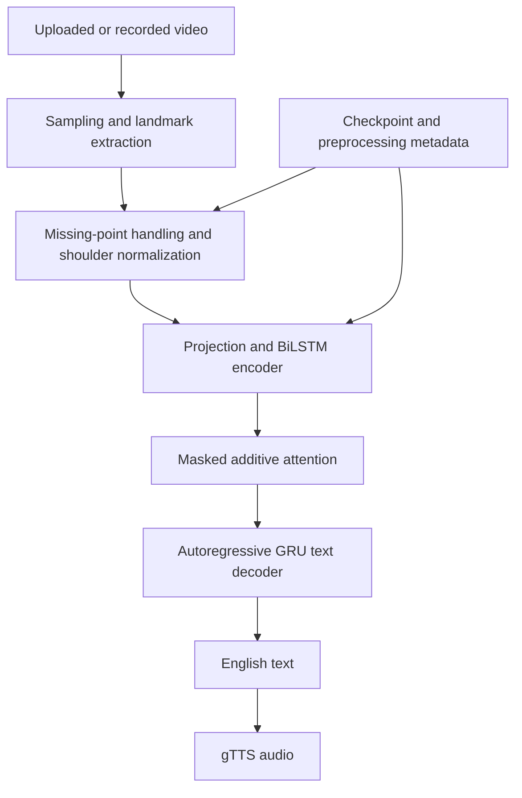
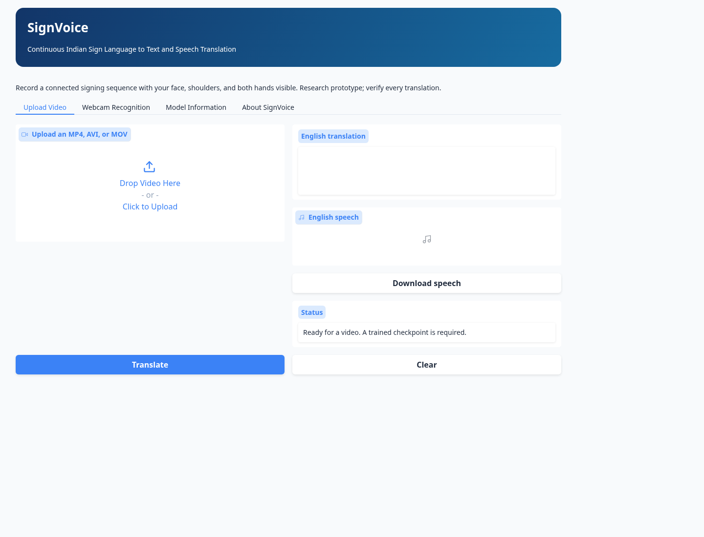
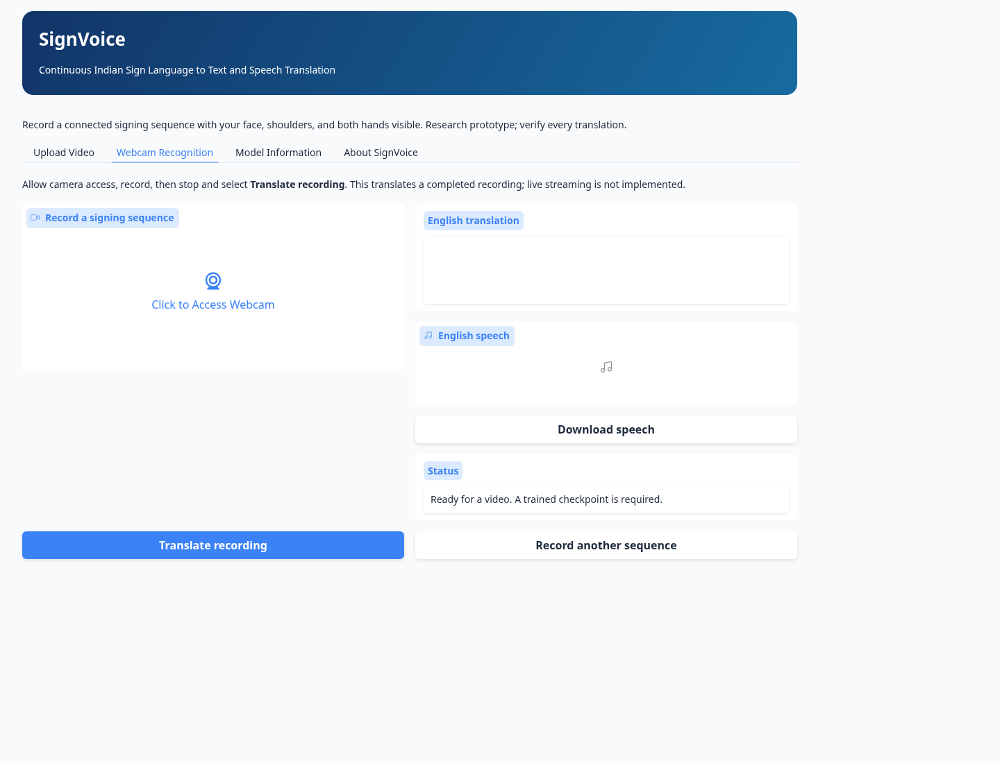
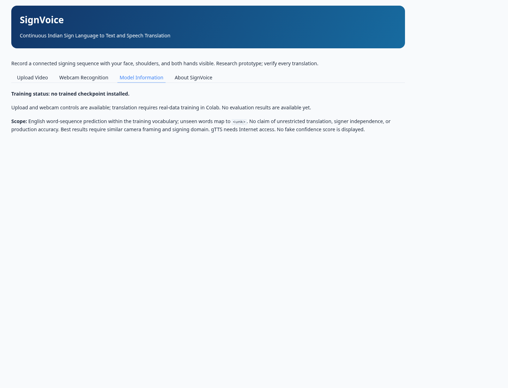

# SignVoice: Continuous Indian Sign Language Recognition and Translation into English Text and Speech Using Deep Learning

**MCA final-year project — implementation report draft**

Experimental sections below explicitly distinguish executed engineering checks from pending dataset experiments. This report is not a claim of completed research evaluation.

## 1. Abstract

SignVoice implements a temporal deep learning pipeline for translating connected Indian Sign Language video into English text and synthesized speech. Video is sampled using OpenCV, represented using MediaPipe body, hand and facial landmarks, normalized and encoded by a bidirectional LSTM. A masked attention decoder generates English word sequences autoregressively. A Gradio interface supports uploaded and webcam-recorded videos through one inference function. Training and evaluation code and a Colab notebook are implemented. At this stage, public annotation inspection and engineering tests are complete, while actual dataset-video access and recognition performance evaluation remain pending due to environment network restrictions. No translation accuracy is claimed.

## 2. Introduction

Sign languages have their own grammar and express meaning through handshape, movement, location, orientation and nonmanual features. Translating Indian Sign Language requires temporal visual understanding and language generation. English word order need not align frame by frame with signing. A sequence-to-sequence approach can learn a conditional mapping without asserting that English words are gloss annotations.

## 3. Problem statement

Given a complete video of connected signing, generate an English sentence and optional audible speech. The problem includes variable duration, missing detections, signer variation, coarticulation, sentence structure and limited aligned data. Webcam recording supplies video input; it is not low-latency streaming recognition.

## 4. Objectives

- Build a reproducible temporal PyTorch model with real-data training and held-out evaluation.
- Share preprocessing and weights across upload and webcam recording.
- Preserve a verifiable feature schema in every artifact.
- Compare a simple baseline with sequence-to-text generation.
- Expose limitations, failures and missing prerequisites transparently.

## 5. Literature review

Joshi, Agrawal and Modi (2023) introduce ISLTranslate for continuous ISL/English sentence and phrase translation. Their resource motivates direct video-to-text learning. The iSign hosting location is linked by its official repository. The supplied ISLiM repository explores a landmark-based visual encoder with a pretrained text decoder; its claims must be independently evaluated and are not reproduced by this project. BiLSTM sequence encoding and additive attention provide a smaller educational model suitable for controlled experiments on Colab. Pose-based systems reduce visual input size but discard appearance details and inherit detector errors. A review should distinguish dataset claims in original papers from measured SignVoice outcomes.

## 6. Existing system

Alphabet recognition and isolated-sign classifiers assume a known class and do not solve connected sentence translation. Sentence classification can produce only a previously defined whole-sentence label. Continuous translation models instead condition a text sequence on the entire visual sequence, but require sufficient aligned data and careful evaluation.

## 7. Proposed system

Use an interpretable lightweight landmark-to-text model as the main experiment. Use a closed-set BiLSTM sentence classifier only for eligible repeated classes, and a most-frequent-sentence baseline for any translation split. Expose recording and upload inputs in a single application with checkpoint validation and explicit service errors.

## 8. System architecture

Offline training creates the checkpoint; the application does not train on user uploads. The decoder attends to valid time steps only. Packed sequences prevent padding from changing encoder final states.

## 9. Dataset description

Provisional source: ISLTranslate raw-video assets hosted at iSign. The official GitHub CSV was inspected at commit `1b599eb2f9c552d165958a95827507169c008016`: 31,222 annotation rows with nonempty UID/text. This is not a count of verified aligned video samples. HF and Kaggle metadata were blocked by proxy 403 responses. GloSL-ISL format and ISL-CSLTR contents remain unverified. Refer to `dataset-investigation.md` for evidence and licensing caveats.

**Pending real experiment:** dataset revision, accepted license, usable video count, signer information, train/validation/test counts and rejection statistics must come from the actual download provenance and `audit.json`.

## 10. Preprocessing methodology

Sample at 12 fps, extracting six body points (shoulders, elbows, hips), 21 points for each hand and 46 facial points. Each point has x/y/z and visibility, producing 376 values per frame. The facial indices are explicitly listed in source. Short internal gaps of at most three sampled frames are interpolated; other missing values remain masked to zero. Coordinates are centered at shoulder midpoint and scaled by 2D shoulder width, with a temporally interpolated reference frame where shoulders are missing. No reliable shoulders or hands causes rejection. Sequences longer than 192 frames are uniformly reduced while preserving order. Up to 60-second, 200-MB recordings are accepted. This limit trades temporal resolution against computation and must be evaluated on long sentences.

All videos, including training videos, pass through the identical extractor. Existing pose archives are not silently treated as compatible. Configurations, hashes and exact video/annotation matching are audited.

## 11. Deep learning model

A linear projection, layer normalization, ReLU and dropout encode each frame into 128 dimensions. A bidirectional LSTM produces 256-dimensional temporal states. The concatenated final states initialize a GRU decoder. Additive attention combines encoder keys with decoder queries, masks padding, and produces a visual context at each output step. An embedding of the previous English token and visual context update the decoder. A linear head predicts the next token. Teacher forcing is used for training; greedy autoregressive generation is used at inference. PAD/BOS cannot be generated; EOS terminates generation. Vocabulary is fitted on training text only; unseen words become UNK, so this is compositional generation within a finite vocabulary rather than unrestricted open-vocabulary translation.

## 12. Training methodology

Use fixed seeds, AdamW (initial learning rate 0.0003, weight decay 0.01), per-token cross-entropy ignoring PAD, norm clipping at 1.0, ReduceLROnPlateau and early stopping after five nonimproving validation epochs by default. Begin with 100 valid aligned examples for debugging, then 1,000–3,000 if access and GPU time permit. Default batch size is 16. Text is limited to 64 tokens including BOS/EOS; report target truncation when auditing the selected data. Save best and last checkpoints, optimizer/scheduler/RNG state, vocabulary and preprocessing metadata to Drive. Resume requires the same dataset contents and architecture.

The main split joins source-video IDs and repeated normalized text before assignment to prevent their overlap. Feature hashes are checked across splits. This is a derived source/text-disjoint split, not an official or proven signer-disjoint split. A group may contain multiple sentences, so counts need not be exactly 80/10/10.

## 13. Evaluation metrics

- **BLEU:** sacreBLEU corpus score, 0–100; full signature is saved. Short/subset scores are unstable and require reference context.
- **WER:** (substitutions + deletions + insertions) / reference word count; lower is better and scores may exceed 1.
- **Exact sentence match:** fraction of normalized predicted sentences matching the reference.
- **Loss:** token cross-entropy for training/validation, not sentence correctness.
- **Classifier baseline only:** held-out accuracy, class coverage and confusion matrix on its separate source-group split.

Test generation is autoregressive. No test examples are used for checkpoint selection. Report examples and failure cases alongside aggregate scores.

## 14. Results and analysis

Executed engineering evidence: see `test-results.txt`, `browser-check.json` and `smoke.json`. A synthetic one-example smoke test exercised gradient updates and checkpoint round trips. Its decreasing loss confirms optimization mechanics only; it is not an ISL experiment. Temporary synthetic test fixtures also exercise resumable training/evaluation. Real-data sample count is currently zero.

| Research result | Status |
|---|---|
| Real-data training/validation loss | Pending dataset-video access and Colab training |
| Test BLEU / WER / exact match | Not measured |
| Real held-out translation examples | Not generated |
| Closed-set classifier accuracy/confusion matrix | Eligibility and training pending |
| Successful raw-video/webcam translation | Not verified |

After training, insert actual `evaluation.json` results, learning curves, prediction comparisons and error analysis. Discuss annotation quality, rare words, signer/domain shift, missing hands and long sentences. Do not copy literature results into this table.

## 15. Application screenshots

These are real browser captures of the current application, explicitly showing an untrained state:

They demonstrate interface rendering, not successful recognition. Add actual translation and audio screenshots only after training and end-to-end tests. A headless browser cannot establish real camera permissions or physical capture quality.

## 16. Limitations

No trained recognition model or evaluation currently exists. Video access is blocked in this environment, and external gTTS connectivity failed. The architecture discards appearance, depends on MediaPipe tracking, has finite temporal/token limits and a finite word vocabulary, and may hallucinate fluent but incorrect outputs. Source grouping is not proof of signer independence. Small-data translation can collapse to frequent sentences. This is unsuitable for medical, legal or emergency interpretation. Webcam live streaming is not implemented.

## 17. Future scope

After establishing a valid baseline, investigate larger aligned subsets, official/signer-disjoint splits, landmark quality inspection, pretrained language decoders, beam search, visual appearance features, nonmanual features, offline speech synthesis and explicit uncertainty calibration. Add sliding-window live recognition only with latency and duplication evaluation. Improve accessibility through feedback from Deaf ISL users and qualified interpreters.

## 18. Conclusion

The project currently supplies executable model, preprocessing, training, evaluation and application components with tested engineering behavior. Completing the recognition research requires verified aligned videos, real-data training and held-out video/webcam demonstrations. The evidence boundary is explicit so the final submission can report measured results honestly.

## 19. References

1. Joshi, A., Agrawal, S., & Modi, A. (2023). *ISLTranslate: Dataset for Translating Indian Sign Language*. Findings of ACL 2023, 10466–10475. https://aclanthology.org/2023.findings-acl.665/
2. ISLTranslate official repository. https://github.com/exploration-lab/isltranslate
3. iSign dataset hosting. https://huggingface.co/datasets/Exploration-Lab/iSign
4. GloSL-ISL dataset hosting (contents unverified here). https://huggingface.co/datasets/pedroodb/glosl-isl
5. ISL-CSLTR Kaggle listing (contents unverified here). https://www.kaggle.com/datasets/drblack00/isl-csltr-indian-sign-language-dataset
6. ISLiM reference repository (external, unreplicated results). https://github.com/ahmedshoaib/ISLiM
7. PyTorch documentation. https://pytorch.org/docs/stable/
8. MediaPipe Holistic documentation. https://chuoling.github.io/mediapipe/solutions/holistic.html
9. Gradio documentation. https://www.gradio.app/docs
10. sacreBLEU implementation and metric signatures. https://github.com/mjpost/sacrebleu
